# Buổi Meet 2026-11-07 (14:31–15:53) — bản chép lời ĐÃ SOÁT

> **Nguồn:** máy chép lời từ video Bandicam (xem [README.md](README.md)), Claude soát lại ngày 2026-11-07.
> Bản gốc chưa sửa nằm ở [transcript-raw/](transcript-raw/).
>
> **Quy ước:**
> - `[h:mm:ss]` = giờ tính từ đầu buổi (0:00:00 = 14:31:28). Cộng 14:31 để ra giờ thật.
> - Lời được **giữ sát nguyên văn**, chỉ sửa chữ máy nghe nhầm (bảng ở cuối file). Không thêm ý.
> - `[?]` = máy nghe không rõ, chưa chắc nghĩa. `[…]` = bỏ đoạn máy bịa (kiểu "hãy đăng ký kênh")
>   hoặc đoạn nói chuyện ngoài lề.
> - **Không phân biệt được ai nói** (máy không tách giọng). Phần lớn là lời người giảng; câu có dạng
>   hỏi ngắn thường là người học. Chỗ nào chắc là người học hỏi thì ghi **HV:**.
> - Chart người giảng chia sẻ: **Sierra Chart, khung M1** — đầu buổi là **NQZ26** (Nasdaq), từ khoảng
>   0:19 trở đi là **GCZ26** (vàng COMEX). Có lúc người học tự chia sẻ màn hình Optimus Flow (GCZ26).
> - ⚠️ Đây là lời giảng, **chưa phải luật đã kiểm chứng bằng số**. Muốn code thành tín hiệu phải qua
>   bước ĐẾM + PHẢN CHỨNG theo `tpo/EVIDENCE-DRILLS.md`.

---

## 1. Stacked imbalance: là vùng, xem vị trí trong nến (0:02:48 – 0:05:00)
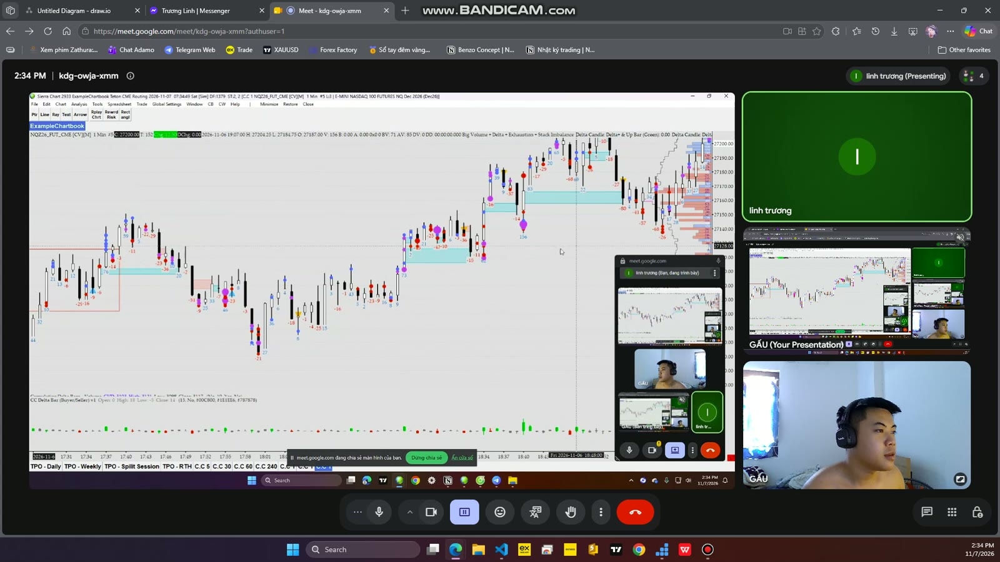 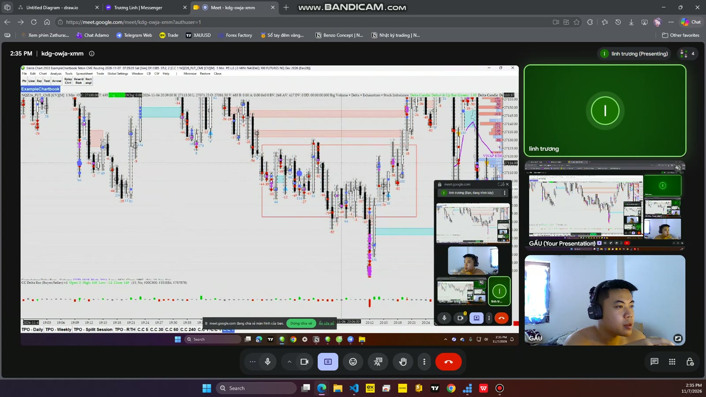

- [0:03:14] Đây là **stacked imbalance sell**, đây là **stacked imbalance buy** — nó là **một vùng chứ không phải một điểm**.
- [0:03:24] Với stacked imbalance này mình phải xem **vị trí của nó ở đâu trong cây nến**. Ví dụ nó ở trên đỉnh nến xong rồi — cái đấy kiểu bị phô ra [?].
- [0:03:35] Còn nếu nó **ở giữa thân nến** thì nó mới khỏe.
- [0:03:40] Hoặc nó ở đỉnh nến cũng được, nhưng sau đấy giá phải đi lên tiếp.
- [0:03:45] Chứ nó ở đỉnh nến xong bị **rút râu xuống** thì cũng không đẹp lắm.
- [0:03:56] Đây nhé, nó **so chéo Ask với Bid**, người ta hay để gấp 3, [người giảng] đang để **250%**.
- [0:04:34] Thì nó tạo ra một cái zone, **zone liên tiếp** này. Zone này cũng thế này.
- [0:04:48] Ví dụ nó trap [?] một phát, xong rồi nó đẩy, đẩy mạnh một phát.

## 2. FVG của ICT bản chất là stacked imbalance (0:04:54 – 0:06:00)
- [0:04:54] Giống như kiểu cấu trúc học ICT, ICT nó hay vẽ **FVG** (khoảng trống giá).
- [0:05:02] **Bản chất FVG không phải là khoảng trống giá, nó là cái stacked imbalance này.**
- [0:05:12] Khi giá đẩy mạnh quá, nó sẽ tạo ra cái vùng mà **chênh lệch mua với bán nhiều**.
- [0:05:22] Ví dụ một xu hướng có nhiều đoạn này, nó trap xong tạo ra imbalance này.
- [0:05:30] Phải xem **vị trí** của cái imbalance nữa.
- [0:05:36] Với lại cái **trap** đấy — ví dụ nó tạo ra xong nó **phá cấu trúc** — thì nó sẽ mạnh.
- [0:05:41] Hoặc dùng để **follow trend** (đi theo xu hướng): ví dụ giá đi lên mà tạo ra stacked imbalance, xong nó test về.
- [0:05:51] Ví dụ chỗ này: thấy nó trap không? Nó trap ở đây, xong nó đẩy lên, đẩy mạnh, tạo ra **2 cái stacked imbalance** luôn.

## 3. Khi nào stacked imbalance hỏng / cách dùng (0:06:29 – 0:07:50)
- [0:06:29] Ví dụ chỗ này tạo ra nhiều stacked imbalance sell, mà lên nó **không giữ được** giá, đâm thủng ngược lên → thì **đảo chiều** thôi.
- [0:06:54] **Dùng gần thôi, đừng dùng xa.**
- [0:07:01] Phải **kết hợp thêm cả bóng** (bong bóng lệnh lớn) nữa, chứ không dùng mỗi stacked imbalance.
- [0:07:08] Ví dụ: đây nó tạo stacked imbalance sell, đâm xuống phá cấu trúc này, xong vòng lên, chạm đúng vùng này, rồi đi xuống.
- [0:07:28] Chỗ này cũng trap xong rồi — đây là sell — trap xong đẩy ngược lên, tạo một cái stacked imbalance.
- [0:07:38] Phải **kết hợp với trap**: ví dụ trap buy, xong đẩy xuống, tạo ra stacked imbalance sell → **dấu hiệu đảo chiều**.

## 4. Đánh phải có bối cảnh range: breakout hay fail break (0:07:47 – 0:09:52)
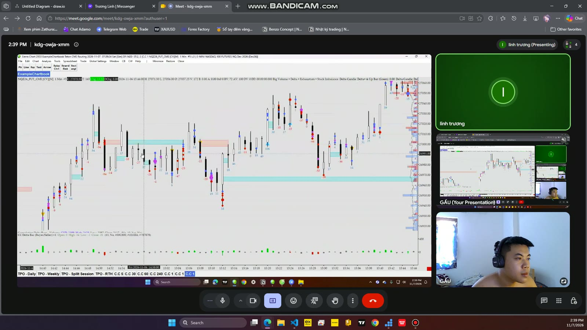 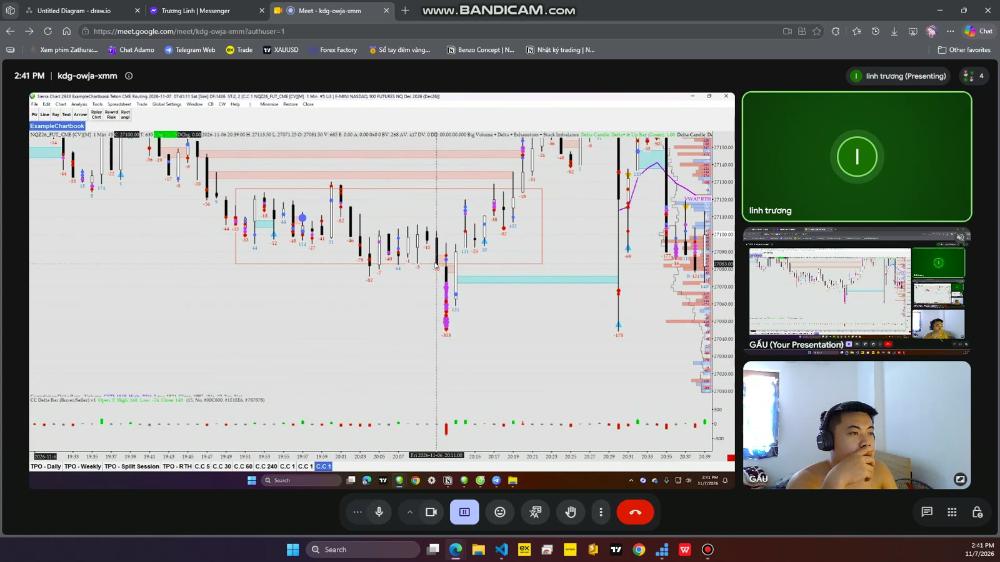

- [0:07:47] Nhưng đánh thì **kết hợp thêm range** mà đánh, đừng đánh mỗi cái đấy. Kết hợp thêm bối cảnh, **vẽ range** mà đánh.
- [0:07:57] Vẽ range như thế này, xem nó **breakout** như thế nào, hay **fail break** như thế nào.
- [0:08:05] Đoạn này nó tạo ra range, xong break xuống. Nó **không có dấu hiệu gì**, đâm ngược lại vào → vẫn ở trong range.
- [0:08:16] Đoạn này nó lên, break ngược lên trên. **Chưa vội buy luôn**, vì chỗ này chưa có dấu hiệu gì.
- [0:08:23] Đoạn này trap sell, nhưng đoạn sau buy yếu thì không vào được.
- [0:08:29] Trap đỉnh ở đây, xong **đẩy ngược vào lòng range**, mà đẩy ngược vào range lại tạo ra **stacked imbalance sell** → lúc đó tìm tín hiệu sell xuống. **Khi nó fail break thì tìm tín hiệu sell.**
- [0:08:46] **HV:** Cái âm 23 [?] đấy chơi được không? — Chơi được. Hoặc cẩn thận thì **chờ 1–2 cây sau** xem nó có **giữ được trong range** không.
- [0:09:32] Có những range xấu, có những range đẹp thì dễ đánh như range này:
- [0:09:42] … fail break đâm ngược vào, **bóng xanh nổ**, trap, sell, **stop hunt**, đẩy ngược vào → buy được.

## 5. Kiệt sức (exhaustion): đỉnh soi Ask, đáy soi Bid (0:10:00 – 0:11:40)
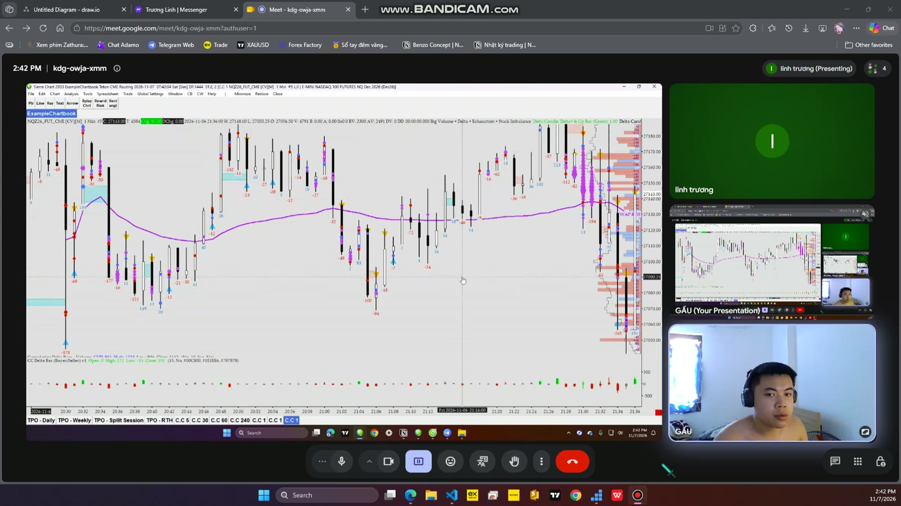

- [0:10:00] Đoạn này đẩy xuống, nhưng ở đáy bị **kiệt sức**, nó hồi lên.
- [0:10:09] Đoạn này sell xuống, đỉnh kiệt sức, sell xuống… Đến cây này, sell xuống lại bị kiệt sức sell — sell bị kiệt sức ở đáy thì hồi lên.
- [0:10:23] **HV:** Tính kiệt sức thế nào?
- [0:10:25] **Kiệt sức: ở đỉnh thì xem bên Ask, ở đáy thì xem bên Bid.**
- [0:10:30] Thấy nó **nhỏ** là được — nhỏ, hoặc **giảm dần về 0** [?] là được.
- [0:10:45] Với lại **kết hợp zone** mà đánh.
- [0:11:20] Cấu trúc bị gãy rồi thì không theo được.
- [0:11:23] Đoạn này cũng tạo ra range → xác định range luôn. Break phá range này, mà **đỉnh kiệt sức** này đẹp luôn → sell vào. Tạo ra cả stacked imbalance nữa.

## 6. Range: chọn khung, vẽ cạnh ở chỗ phản ứng nhiều (0:12:39 – 0:16:40)
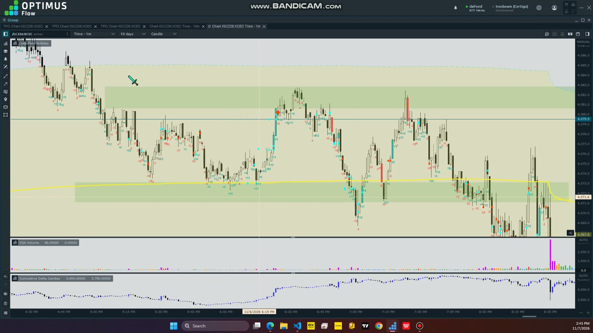

> Đoạn này người học chia sẻ màn hình **Optimus Flow (GCZ26)** của mình.

- [0:12:39] Như đoạn này break range, đoạn này buy chưa mạnh nhất, đoạn này mới **confirm** được buy, xong **retest** về, đáy bị kiệt sức, buy lên.
- [0:12:56] **Một vùng tích lũy đi ngang thôi là nó là range rồi.**
- [0:13:58] Range thì chắc phải **khung 15** [?máy ghi "1 năm"; ngữ cảnh là khung lớn hơn M1] … **Range dùng khung [15] thôi. M1 thì không dùng đâu, M1 dùng range nhỏ hơn.**
- [0:14:42] **2 vùng chồng nhau thì gộp lại 1 vùng.**
- [0:14:50] Cái cạnh range: **chỗ nào nó phản ứng nhiều** thì lấy làm cạnh.
- [0:16:12] Tức là có range, xong rồi có trap thì sẽ là trap…
- [0:16:25] Cần range, chỉ là [xác nhận] thôi.
- [0:16:29] Khi nó đi range, khi có dấu hiệu range → **phải chờ đánh theo range**; còn khi nó **trend** thì mới **đánh theo trend**.

## 7. Stacked imbalance làm mốc tham chiếu khi đi theo xu hướng (0:17:20 – 0:18:50)
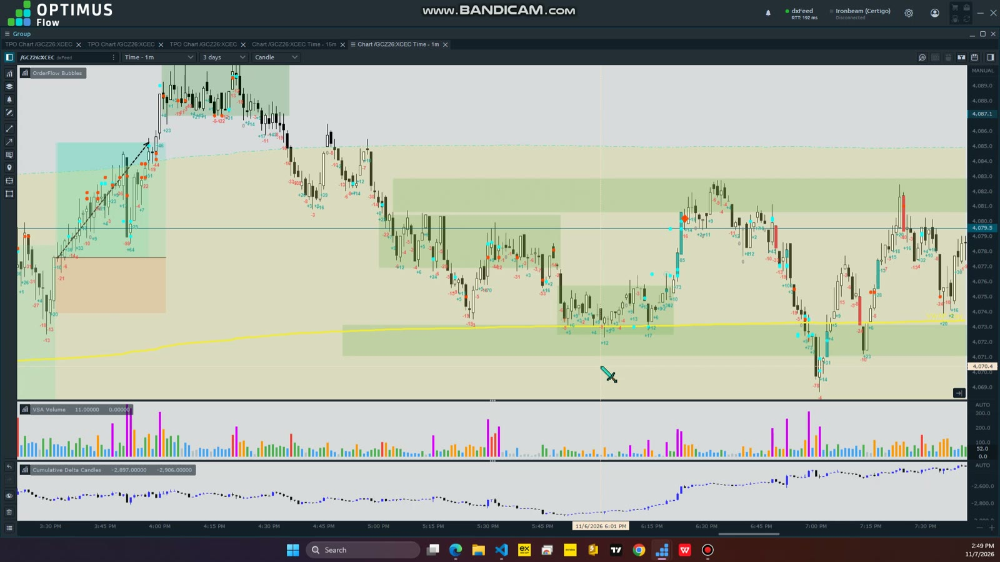

- [0:17:20] Dùng khung nào thì tìm **cấu trúc** của khung đấy thôi.
- [0:17:46] **HV:** Có thể nhận thêm một điều kiện nữa để ủng hộ cho [lệnh] không?
- [0:17:58] Ví dụ khi nó tạo stacked imbalance được, thì dùng ở đấy để **follow**, dùng làm **mốc tham chiếu** — để giá về đấy xem phản ứng trước rồi mới buy lên.
- [0:18:13] Hoặc khi thị trường đẩy mạnh, test về mấy stacked imbalance mà **không phản ứng** [ngược] — thì buy thôi.
- [0:18:21] Ví dụ buy, có stacked [imbalance] gần này, nó lên, xong **quay lại test stacked gần** → chơi.
- [0:18:39] **Với điều kiện lúc đấy cấu trúc vẫn phải giữ được.** Ví dụ cấu trúc buy thì cấu trúc tăng vẫn phải giữ. Nhịp test về mà **gãy cấu trúc rồi** thì thôi.

## 8. Vì sao một stacked imbalance được dùng, cái kia bỏ (0:19:17 – 0:22:15)
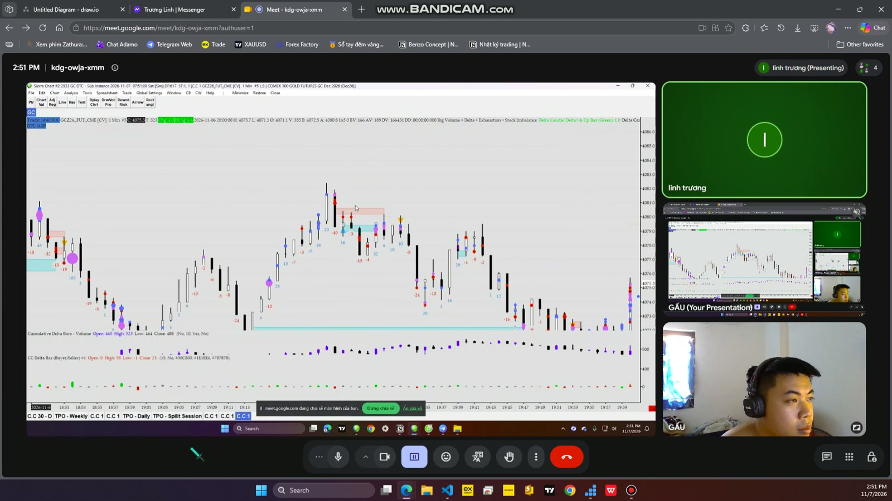

> Từ đây chart chuyển sang **GCZ26 M1**.

- [0:19:23] Chỗ này đang tăng, xong nó trap, **nổ bóng đỏ**, tạo ra stacked imbalance [sell].
- [0:19:31] Xong nó bị gãy cấu trúc này, phá cấu trúc này — mặc dù ở dưới tạo ra 1 stacked imbalance buy, nhưng **đáy bị kiệt sức**.
- [0:19:38] Cái stacked imbalance này xấu hơn cái ở trên vì: nhìn **vị trí stacked imbalance trong cây nến** — nó nằm **gần đỉnh nến, gần râu**; còn cái này nằm **giữa nến**. Với lại cấu trúc bị gãy.
- [0:19:55] Thấy nó tôn trọng [vùng] thì sell xuống; **gãy cấu trúc thì sell xuống**.
- [0:20:00] Lúc ấy cấu trúc gãy rồi, với lại nó cũng **ở xa rồi** → không dùng.
- [0:20:12] Ở đây nó tạo ra 1 stacked imbalance 3 lần sell, mà bên trên nó **chạm một mớ** ở đây, tạo stacked 3 lần → **cái stacked này vứt luôn, không dùng nữa**. Cấu trúc thì gãy.
- [0:20:31] Hoặc đây: cấu trúc, **bối cảnh với range**. Trap phá range đâm xuống, **retest lên range**, retest luôn cái stacked imbalance này → sell xuống. Chỗ này **đỉnh kiệt sức** nữa (thấy cái bóng không?).
- [0:21:25] Đoạn này trap xanh, trap đỉnh, xong tạo [stacked] sell rồi rơi xuống tiếp.
- [0:21:34] **HV:** Thấy cây lúc 10:58 [?] không? … 16:15 — chơi được không? — Chơi được, chơi từ cây …08 / …10.
- [0:21:59] Vì ở đây nó **trap đúng vùng zone** này. Với lại **cấu trúc đang còn giảm** — ít nhất phải **phá qua cái đỉnh này** thì cấu trúc mới gãy.
- [0:22:53] Bóng xanh nhồi cao lên mấy cái gần … [?], lên nổ bóng, xong mới đâm ngược xuống. Trên đỉnh tạo ra stacked imbalance — tức là lên trên bị **lệch sell nhiều**, imbalance sell ngay trên đỉnh. Đâm xuống, phá range.

## 9. Stop hunt: quét SL ở mốc quan trọng (0:23:45 – 0:24:40)
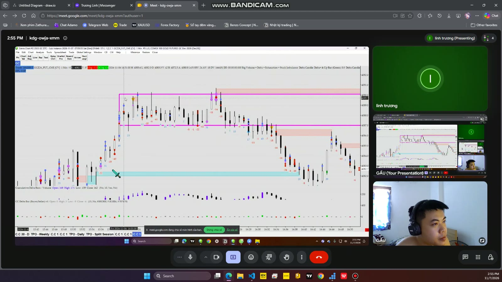

- [0:23:45] **HV:** Stop hunt là gì? — [Stop hunt] là **quét SL**: ví dụ nó quét qua cái đỉnh này mà **nổ bóng** thì là stop hunt.
- [0:23:48] **HV:** Nhưng cái mốc quét ấy phải là mốc quan trọng, đúng chỗ quét SL đúng không?
- [0:23:57] Cái mốc đấy phải là **một cái mốc quan trọng**. Nó có thể xuất hiện ở nhiều nơi, nhưng phải xác định được đâu là **điểm quan trọng** — thì biết là chỗ đấy **dễ có người đặt SL**.
- [0:24:11] Ví dụ trên này **đi range**, thì thường người ta đặt SL **trên đỉnh này một tí**, hoặc nói chung là **quanh cạnh range bên trên một tí**.
- [0:24:28] Đây nhiều SL, mà thấy **nổ bóng xanh** → chắc chắn ở đây **không phải người mua thật** rồi.
- [0:24:34] SL ở đây là **lệnh buy-stop**, mà lệnh buy-stop **cũng là nổ bóng xanh**.

## 10. Một lệnh buy chủ động — 3 hành vi khác nhau (0:24:38 – 0:29:56)
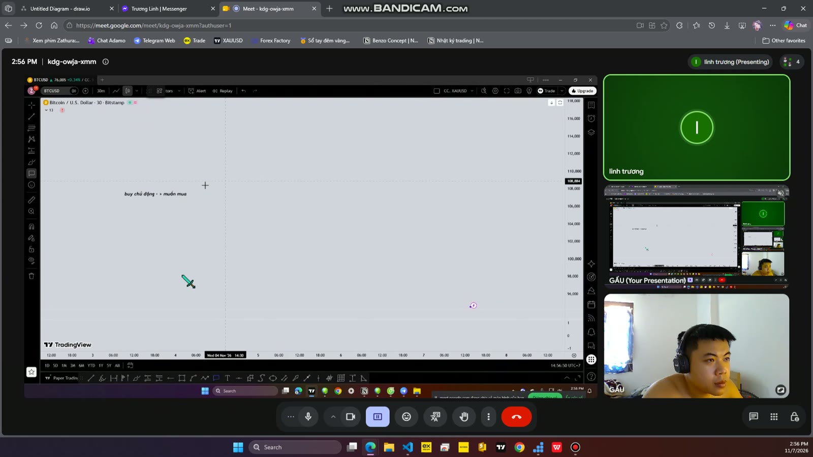 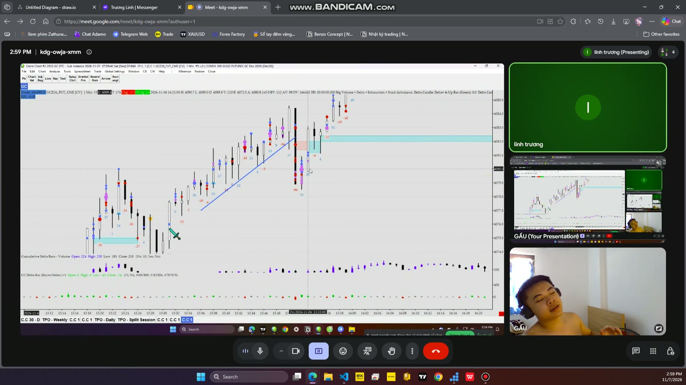

> Người giảng chuyển sang TradingView (BTCUSD) để vẽ sơ đồ "buy chủ động ≠ muốn mua".

- [0:24:38] Phải hình dung cái **lệnh chủ động**: hành vi phía sau nó **không phải chỉ là muốn mua** đâu.
- [0:24:52] Đây là **buy chủ động**. Nghĩ buy chủ động là người ta muốn mua đúng không? Nhưng hành vi phía sau còn nhiều hành vi.
- [0:25:09] Thứ nhất: **lệnh SL của bên sell cũng là lệnh buy-stop**, tức là cũng vào **buy bằng market** (buy chủ động).
- [0:25:35] Tức là **cùng một loại lệnh** đẩy vào [sổ lệnh] là buy chủ động, **nhưng 2 hành vi khác nhau**: một là **muốn mua**, một là **bị ép phải mua — mua để thoát lệnh bán** (cắt lỗ sell).
- [0:25:49] Còn một hành vi nữa: **chốt lời**.
- [0:25:58] **HV:** Chốt lời buy? Hay chốt lời sell? — **Chốt lời sell.** (Người giảng nói bức ảnh minh họa [trước đó] không đúng.)
- [0:26:15] Ví dụ giảm mạnh như thế này, xong hồi lên, nhịp hồi lên này sẽ có mấy mức. **Chốt lời sell cũng là chốt bằng lệnh chủ động được.**
- [0:26:27] Ví dụ sell 1.000 lot ở đây; tới chỗ này buy chủ động 1.000 lot → ở vị trí này nó **thoát được 1.000 lot sell**.
- [0:26:48] **Cùng 1 lệnh buy chủ động nhưng có 3 hành vi:**
  1. **Ép người bán phải cắt lỗ** (giá hồi lên chỗ này ép người sell cắt lỗ).
  2. **Muốn mua thật.**
  3. **Lệnh thoát lệnh sell** (chốt lời sell).
- [0:27:12] Kể cả **lệnh limit** cũng có 2 hành vi: **một là muốn sell thật, hai là muốn chốt lời**.
- [0:27:22] Phải **đặt bối cảnh** vào để nhìn, **chứ không phải cứ thấy bóng xanh là bảo mua**. Nó chốt lời? Nó cắt lỗ?
- [0:27:36] Như đoạn này tăng tạo cấu trúc thế này, nó quét qua cấu trúc mà thấy nổ bóng, đánh ngược lên.
- [0:27:59] Đoạn cây to đùng như thế này thì khả năng **những lệnh sell này không phải muốn sell**, mà là lệnh của **bên buy chỗ này bị SL** — buy chỗ này bị quét mạnh thì phải **cắt lỗ bằng lệnh sell chủ động**.
- [0:28:50] Ví dụ chỗ này có 1.000 thằng: nếu muốn sell thật thì giá có thể giảm; nhưng chỗ này 1.000 thằng đấy **chỉ muốn chốt lời buy** thôi.
- [0:29:03] Chốt lời buy: mua ở dưới, lên đấy muốn chốt lời, **đặt sell limit ở đây** — chứ không phải muốn sell thật ở đấy.
- [0:29:45] Lên này nó muốn chốt; nếu dùng lệnh chủ động hay bán luôn ra thì cũng **nổ bóng** như thế này. Nó chốt lời bằng [lệnh] sell.
- [0:29:56] → **Nhìn bối cảnh mà đánh.**

## 11. Delta đi ngược giá = hấp thụ / kiệt sức (0:31:00 – 0:32:11)
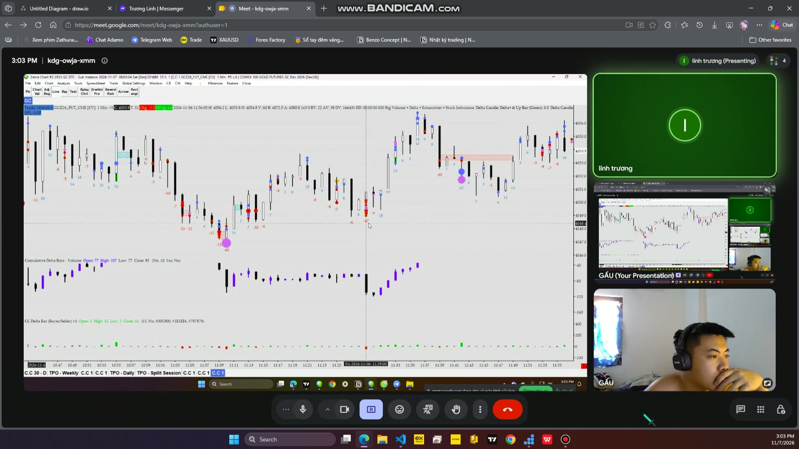

- [0:31:00] Có thể dùng **buy hay sell** [delta] để xem có **phân kỳ** hay không.
- [0:31:20] Đây là cái đáy, **đáy quan trọng**. Khi retest xuống chỗ này, delta đẩy đà nó phá đáy này, **nhưng giá không phá đáy** — chỉ là nó **bị hấp thụ**.
- [0:31:37] **HV:** Tức là delta không đi theo giá đúng không?
- [0:31:42] Delta phải **đi theo giá** thì mới **đồng thuận**. Còn nó **đi ngược giá** là bị **hấp thụ**, bị **kiệt sức**.
- [0:31:49] Với lại nhìn **cấu trúc của delta** để xem **buyer hay seller đang kiểm soát** — xem seller kiểm soát nhưng giá đi như thế nào, để biết hành vi có **tương xứng** không.

## 12. Kiệt sức lấy ở râu nến; chấm vàng/xanh; delta to-nhỏ (0:33:14 – 0:36:43)
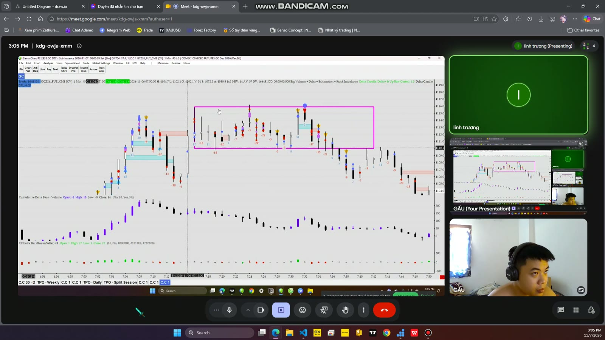 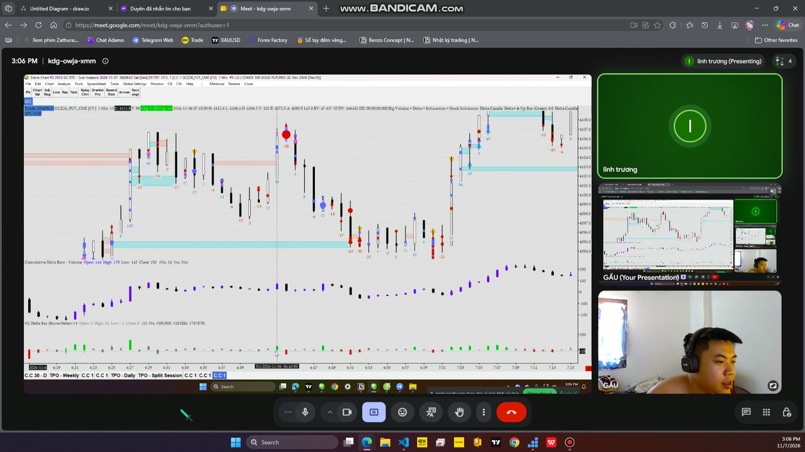 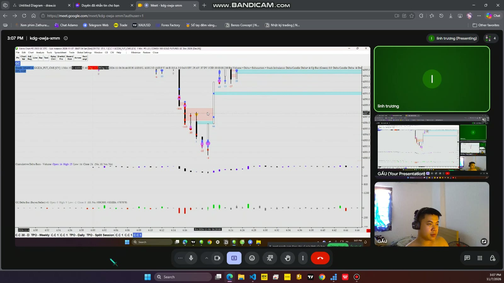

- [0:33:14] [Kiệt sức] **lấy ở râu nến thôi, đừng lấy ở thân nến**. Số kiệt sức là ở **râu nến**.
- [0:33:28] Như đoạn này là kiệt sức ở đỉnh — buy lên toàn bị kiệt sức → giảm thôi.
- [0:33:36] Đoạn này lên test, buy bị kiệt sức. Đoạn này giảm xuống, buy cũng bị kiệt sức.
- [0:33:46] Nhưng nó chỉ cần phá 1 hay 2 đầu thì là được [?].
- [0:33:55] **Màu vàng là kiệt sức buy, màu xanh là kiệt sức sell.** (chấm màu trên chart Sierra của người giảng)
- [0:34:08] Cái này để xem **delta to hay nhỏ**. … Buy mà **delta nhỏ**, lình xình thì để ý vào.
- [0:35:30] **HV:** Nó rất to, thấy nó chậm một đoạn và delta cứ nhỏ nhỏ — thì nó đang yếu?
- [0:35:42] Muốn buy hay sell mà **đánh đảo chiều**: ví dụ đoạn này đánh đảo chiều vòng lên mà thấy **delta nhỏ thì không chơi được**.
- [0:35:55] **Delta dương nhưng nhỏ thì không đánh được.** Muốn đảo chiều thì delta phải **dương to lên, thẳng lên**.
- [0:36:21] Ví dụ ở đây có cây kiệt sức buy, nhưng lúc sau buy mạnh lên → đảo chiều thì [cần] kiệt sức buy, **với lại quan trọng phải phá được cấu trúc** — đừng nhìn mỗi cái đấy.

## 13. Phá cấu trúc + phá range (0:37:44 – 0:41:19)
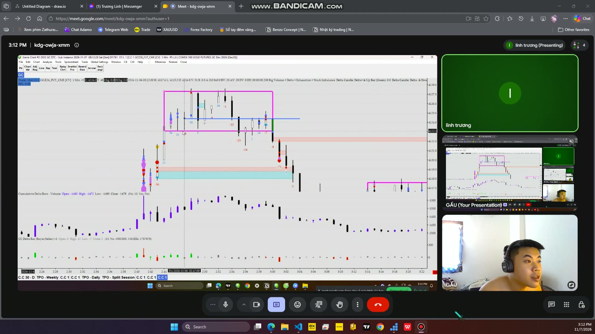

- [0:37:44] Vì nó bị **rút râu** nên phải chờ đoạn này tạo ra được stacked imbalance ở đây, may ra đến cây này chơi mới được.
- [0:38:39] Nó [sell] ở trên này, sell mạnh xuống, **sell không tạo được kết quả**, buy nhảy vào đẩy ngược lên → tính buy là tính từ đoạn này lên.
- [0:38:57] Đoạn này **range mà đánh**: đi kênh, đi range thì chờ xem nó phản ứng thế nào. Có dấu hiệu range thì **kẻ range mà đánh**.
- [0:39:16] Mấy cái này không có trong [range] nữa thì bỏ — vì **break range** rồi, chứ không phải như lúc nãy bắt buy lên.
- [0:40:00] Tạo ra được những stacked imbalance **đối ngược lại**. Thứ hai là nó tạo ra **range và break range**. Range ở dưới: nếu phá range này thì nó sẽ **về range dưới này**.
- [0:40:22] **HV:** Phá vỡ cấu trúc của range hay của…? — **Vừa phá vỡ cấu trúc, vừa phá vỡ range.**
- [0:40:46] Cái nến đen này là cái gãy cấu trúc. Cấu trúc [buy] lên trap, còn nổ bóng xanh trên đỉnh. Tăng lên như này, **đóng xuống cây đen này, không tăng lên tiếp** → gãy.

## 14. Thân nến là vùng giá trị nhỏ; cấu trúc chỉ cần 1 nến (0:41:51 – 0:43:58)
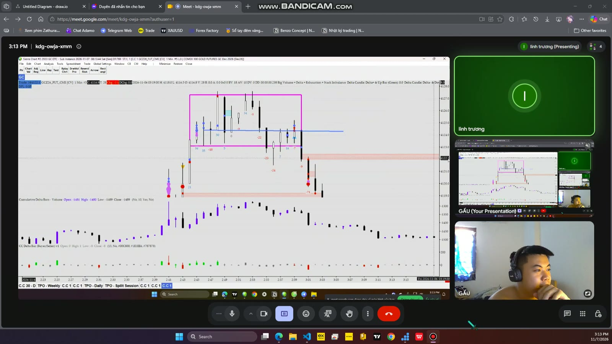

- [0:41:51] Hình dung: **cái thân nến này là vùng giá trị**. Lúc break lên thì đây là vùng giá trị. Khi nó **break được vùng giá trị này** thì gãy luôn — gãy vùng giá trị.
- [0:42:23] **HV:** Tưởng phải vài cây nến cho nó mạnh hơn? — **Chỉ cần một cái nến thôi.**
- [0:42:34] Cấu trúc khả năng là ở đây, ở đây — đây là cái đỉnh/đáy cấu trúc buy với sell. **Chỉ cần nhỏ thôi, gần nhất thôi.**
- [0:43:09] Một cái là **gãy cấu trúc giảm**, một cái là **hình thành cấu trúc tăng**: tạo 2 đỉnh đáy cao dần cũng là cấu trúc tăng.
- [0:43:53] Nó phá thì **phải giữ được** ở [vùng] dưới thì mới tính. Phá mà rút râu luôn thì khả năng là **fail**.

## 15. Đoạn đi range xấu thì khó; delta + bóng xác nhận (0:45:02 – 0:48:49)
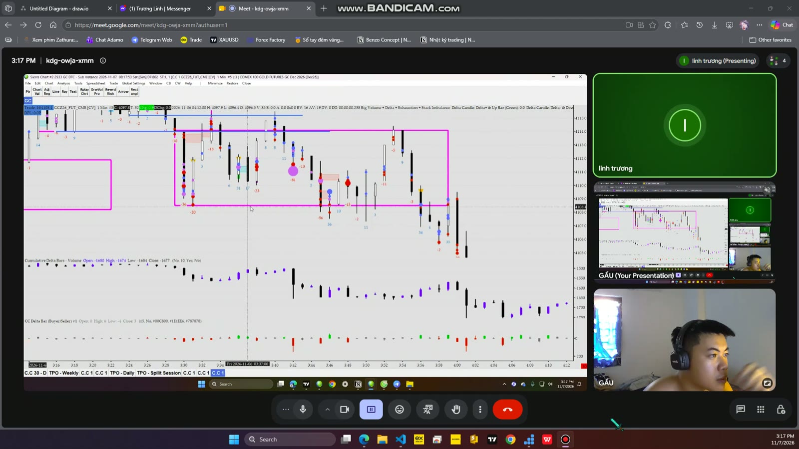

- [0:45:02] Đoạn này đi hơi xấu. Đoạn này **range chồng range** thì khó.
- [0:45:30] Nó lại đấu giá ở dưới này… Đoạn này quét xuống nữa mới đi được.
- [0:45:48] Xong tìm xem có tín hiệu buy vào không thì buy lên. Cứ **nhìn xem delta có đi lên không**, hay **buy có khỏe không**.
- [0:46:03] Như đoạn này **stop hunt**: có **bóng đỏ** → chắc chắn stop. Nếu buy thì đặt SL dưới cái đáy này. Nhưng chỗ này chưa buy được.
- [0:46:13] **Delta buy với bóng xanh** phải vào [thì mới có tín hiệu]. Đoạn này trap xong, **buy có vào đâu** — thấy không, nó nhỏ mà. Cây 10 kia cũng không vào được: nhỏ mà, **không có bóng xanh**.
- [0:46:36] Đoạn này giảm, mặc dù không có bóng, nhưng test lên [?] vào luôn. Thấy cái range này không?
- [0:47:51] Nếu thấy rối quá thì phải lên **khung 15** [?máy ghi "1-5"] — vì nó rõ ràng hơn.
- [0:48:07] Như đây là **range nhỏ**. Đoạn này trap xong nhưng buy hơi yếu → vẫn không vào được.
- [0:48:28] Đoạn này quét cũng kiểu **chưa dứt khoát**. Đoạn retest lên trên này có thể xem, nhưng **cấu trúc gãy rồi**.

## 16. Cấu trúc nhỏ trong cấu trúc lớn; mốc quan trọng (0:48:46 – 0:49:53)
- [0:48:46] Nhưng cấu trúc quan trọng thì vẫn chưa [gãy], vì đây có một **mốc quan trọng**.
- [0:48:59] Mới bắt đầu nhìn thì phải nhìn được **chỗ quan trọng** — những chỗ thấy giá đi ngang / phản ứng.
- [0:49:07] Đây là một chỗ cấu trúc quan trọng; **phá qua đây là phá cấu trúc quan trọng rồi**.
- [0:49:20] Còn đoạn tăng lên như thế này là **cấu trúc nhỏ trong cấu trúc to** — một sóng tăng nhỏ trong một sóng giảm to.
- [0:49:36] Đây là điểm quan trọng của sóng giảm này: **khi phá qua đây thì cấu trúc giảm mới gãy**.

## 17. Đặt SL ở đâu (0:49:57 – 0:51:54)
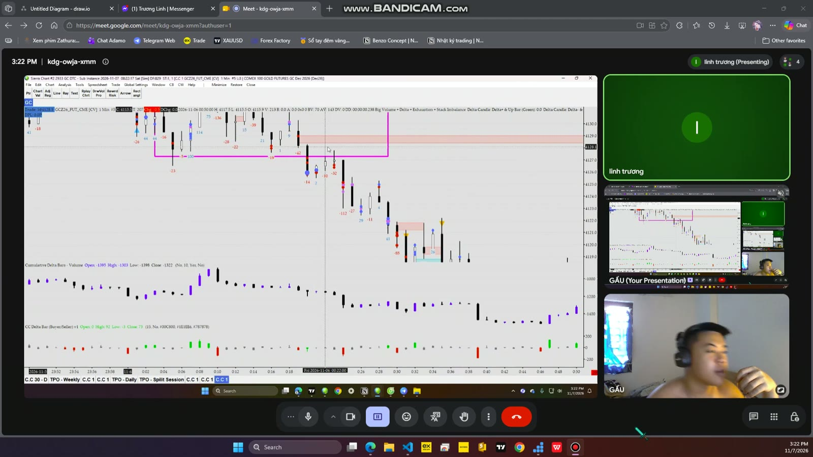

- [0:50:06] **HV:** Chơi cây … [?] được không? Chơi lại không biết đặt dừng lỗ ở đâu.
- [0:50:18] Muốn chơi thì vẫn được, nhưng phải **đặt dừng lỗ trên cái đỉnh này**.
- [0:50:25] **HV:** Sao xa thế, không đặt ngay dưới cái kia? — **Đặt gần thì dễ bị quét.** Nhiều lúc nó **quét râu** lên, không đóng nến lên nhưng vẫn quét râu. Còn chỗ này **quan trọng**, đặt ở đây **khó bị quét hơn**.
- [0:50:54] Đoạn này là … [?], đám bóng này là SL, đẩy ngược lên bóng xanh.
- [0:51:16] **HV:** Chơi được ở K4 hay K5 [?] không? — SL phải ở dưới này; nếu SL bị xa quá thì thôi.
- [0:51:25] **HV:** Tưởng đặt dưới đáy chỗ quét SL? — Ừ, **đặt dưới cái đáy mới quét** [cái đáy vừa bị quét].
- [0:51:54] **HV:** Đoạn này break lên, retest lên, vào tay đánh cái này, đánh theo break, SL dưới …? [?]

## 18. Kiệt sức bị VÔ HIỆU khi giá quét râu qua (0:53:03 – 0:55:20)
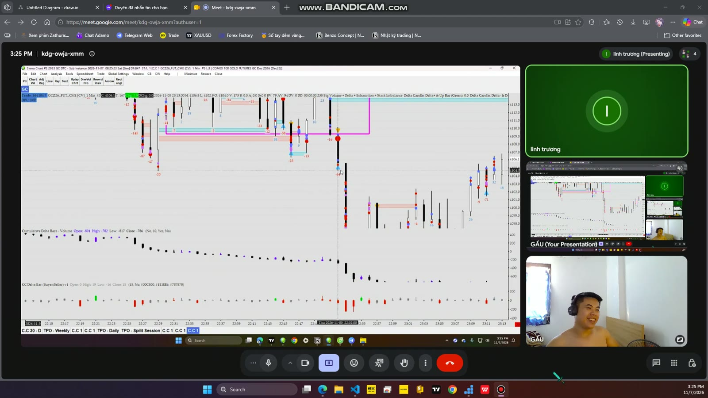 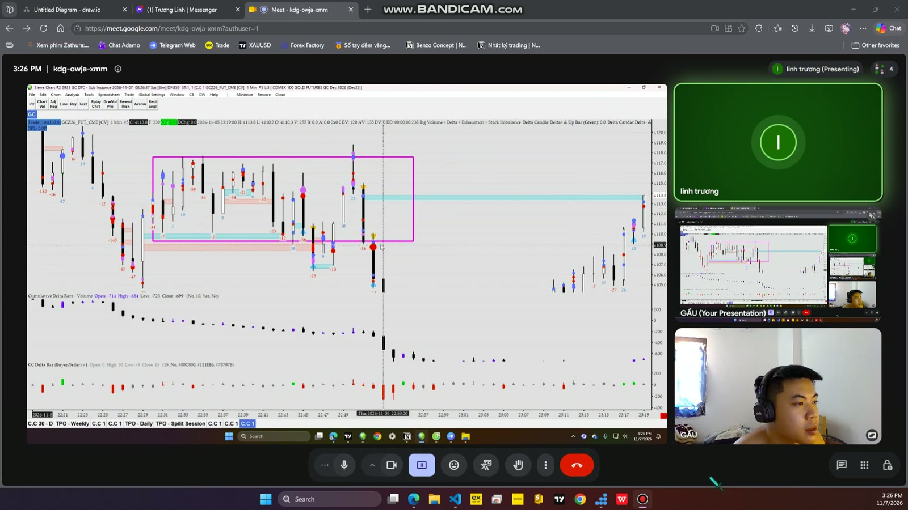

- [0:53:05] Vì cái âm 34 [?] này: ví dụ kiệt sức ở đỉnh là kiệt sức buy, **đáy bị kiệt sức sell**. Sell xuống, đáy bị kiệt sức lúc đấy → hơi không muốn sell.
- [0:53:19] **HV:** Nhưng tín hiệu ủng hộ sell nhiều hơn phải không? — Ủng hộ, nhưng biết đâu nó đảo chiều.
- [0:53:27] Đoạn này nó tạo đáy. Đúng lý ra nó break thì **phải sell mạnh**, tại sao sell lại bị **kiệt sức** ở vị trí này?
- [0:53:35] Thì phải **quan sát cây sau**: cây sau **quét râu qua cái đáy này** → ok là **sell vào lại rồi** → lúc đấy mới sell được tiếp. Nếu **không quét được qua đáy** thì [kiệt sức vẫn còn hiệu lực].
- [0:54:05] Kiệt sức đáy: **điều kiện là giá phải quét qua được cái đáy này thì kiệt sức mới bị vô hiệu**, thì mới chơi [sell] được.
- [0:54:13] **HV:** Quét qua, hay phải đóng nến ở dưới? — **Quét qua là được rồi, không cần [đóng nến].**
- [0:54:29] Nó kiệt sức, đẩy bị yếu. **Chỉ cần quét qua — râu qua — là [người bán] vào lại rồi.** Kiệt sức là ở mức giá đó [không có ai giao dịch], nếu không chạm lại nữa [thì vẫn là kiệt sức].
- [0:54:43] **Đỉnh thì kiệt sức buy — đỉnh không có người mua. Đáy thì kiệt sức sell — đáy không có người bán.** Chỉ cần quét qua là có người mua lại / có người bán lại rồi — **không còn kiệt sức nữa**.
- [0:55:06] Như đoạn này: kiệt sức, xuống đây không có người bán nữa, đẩy ngược lên. Đoạn range thì chỉ cần **quét qua râu** thôi là có người mua lại rồi, đánh lên được.

## 19. Không phải lúc nào cũng đánh theo cấu trúc (0:55:54 – 0:57:56)
- [0:55:54] Tăng như thế này **yếu**: đoạn này đánh đảo chiều không được, [đánh] cấu trúc thì vẫn được.
- [0:56:05] Đoạn giảm như thế này có cùng tín hiệu đấy, nhưng **đang giảm mạnh** thì không buy được, không đánh đảo chiều được.
- [0:56:14] Còn đoạn tăng như thế này, nhìn tưởng mạnh, nhưng thực ra **rất yếu**: sell lên, tăng lên đều cao toàn bị [hấp thụ/kiệt sức], rồi lại đè xuống → **lúc đấy mới đánh đảo chiều được**.
- [0:56:28] **Không phải lúc nào cũng đánh theo cấu trúc.** Đoạn này có thể đánh range, hoặc đánh bình thường cũng được, vì **biên độ dao động cũng to**.
- [0:56:49] Đánh range thì đánh ở đây — **đọc bối cảnh vào là đánh**. Lên đây yếu, **fail break range**, nhìn delta: delta giảm dần, xong đóng ngược lại vào range → sell, SL trên đỉnh yếu này được không? — [được].
- [0:57:46] Bóng đỏ, đẩy ngược lên, nhưng đoạn đẩy ngược lên lại **không có ai mua** → buy đó không phải mua, chỉ là gãy.

## 20. R:R tối thiểu 2R (0:57:58 – 0:58:57)
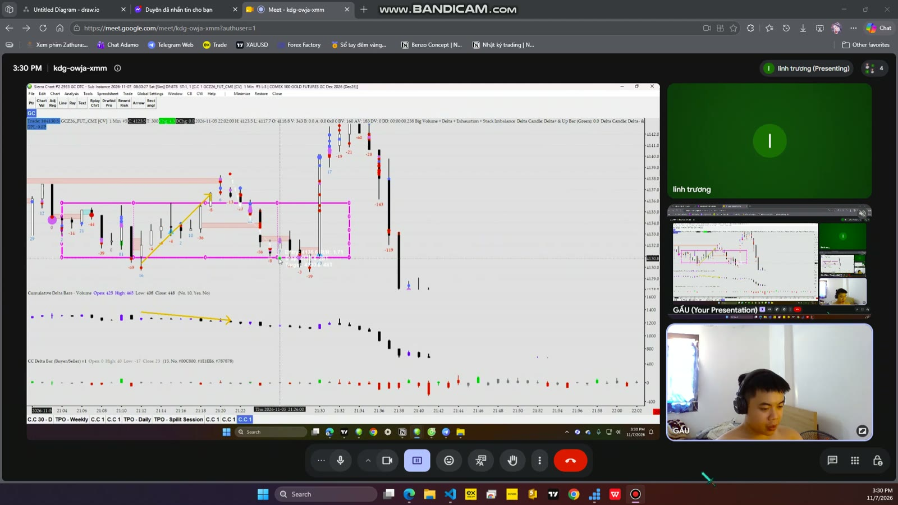

- [0:57:58] **HV:** Nếu không được tầm **2R** thì có chơi không? Ví dụ cây … [?] được 2R không?
- [0:58:13] **Nếu không 2R thì không chơi nữa — kể cả 1R [cũng không].**
- [0:58:29] Nếu vào lệnh sâu quá thì nó sẽ thành 1,5R hay 1R thôi.
- [0:58:35] Cứ xác định từ chỗ vào đến [cạnh] range này **1,7R** — nó sấp sỉ 2R rồi thì có thể [chơi], vì nhiều lúc nó quét râu qua rồi cũng chạy luôn.
- [0:58:49] **Tầm 1,7R là được. Nhưng TP vẫn cứ đặt 2R.**

## 21. Tín hiệu phải vào lại lòng range (0:59:03 – 1:00:27)
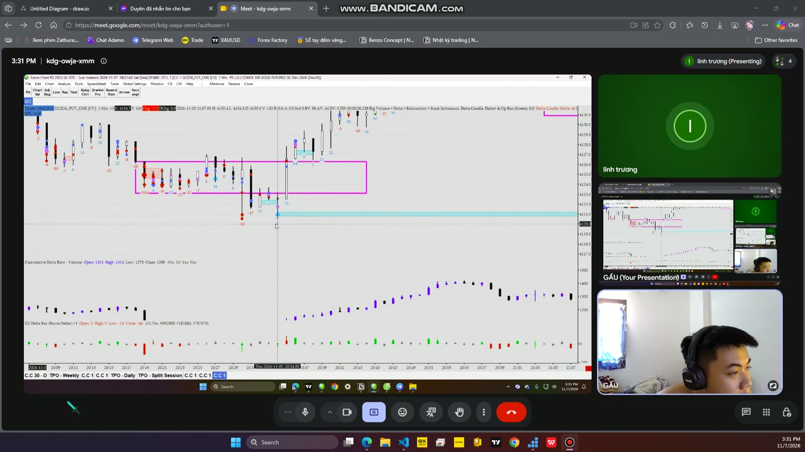

- [0:59:03] Đoạn này kẻ range rồi mà đánh.
- [0:59:07] Đoạn này trap sell, kiệt sức buy… range [?]. Buy không vào, nhưng tạo ra **1 stacked imbalance 3 lần** [?]. Đoạn này dừng hẳn xuống, retest lại, kiệt sức buy → vào, SL ở dưới đấy.
- [0:59:37] **HV:** Cây K23 [?] sao không vào? — Vì nó **vẫn ở ngoài range**, mà tín hiệu mới có **mỗi một cái**.
- [1:00:02] **HV:** Nó có tín hiệu mà chưa vào lòng range đúng không? Điều kiện là phải vào lòng range à? — **Ừ, phải vào lòng range nữa.**
- [1:00:09] Nhưng đến cây này: chưa vào lòng range nhưng nó **confirm lại lần 2** rồi — nó trap đáy một lần nữa và bị **kiệt sức đáy** → vào được.

## 22. Test lại: chờ xem có bán mà bị hấp thụ không (1:00:59 – 1:02:34)
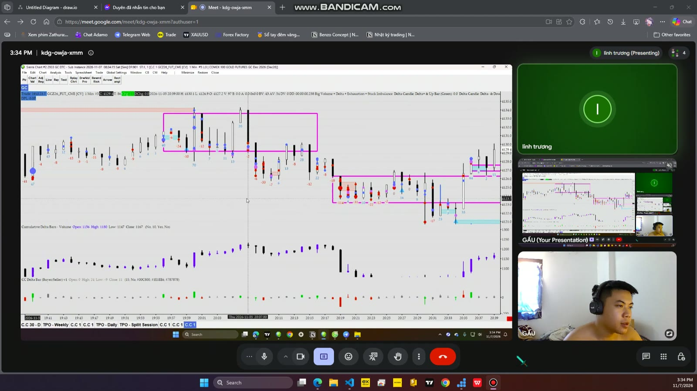

- [1:00:59] **HV:** Chơi cây K6-4 hay K11 [?]? — K11 cũng được; break thì chơi cái đấy.
- [1:01:13] Xem nó phản ứng thế nào, có đẹp không. K11 đẹp rồi → vào thôi.
- [1:01:21] Test này **có ai bán không**? **HV:** Nếu có bán thì sao? — **Chờ xem có đánh ngược lên không, hay có hấp thụ gì không.** Nếu **bán nhiều mà bị hấp thụ** thì chờ theo hướng hấp thụ mà đánh.
- [1:02:15] **Hấp thụ là: mua nhiều không tăng, bán nhiều không giảm.**
- [1:02:28] **Đặt bối cảnh vào thôi** — vì bán đấy có thể là **chốt lời**, mua cũng có thể là chốt lời.

## 23. Phá cấu trúc phải ĐÓNG NẾN; râu nến không tính (1:03:36 – 1:04:30)
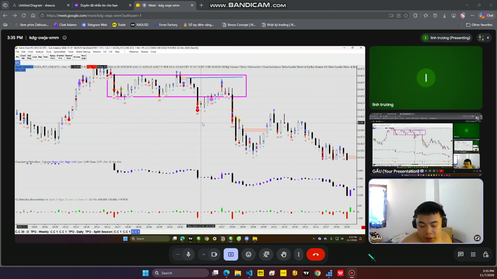

- [1:03:40] Cây này nhìn [volume] to, nhưng cây này là **cây hấp thụ** — bối cảnh cho biết mình cần làm gì.
- [1:03:48] **HV:** Phá [cấu trúc/range] thì cần râu phá một chút, hay phải cả **thân nến** phá?
- [1:04:00] **Thân nến chứ — phải nến đóng cửa chứ. Dùng nến đóng cửa hết.** Sáng nay [?] cũng dùng nến đóng cửa. **Không dùng râu nến đâu**, râu nến không quan trọng [cho việc phá cấu trúc].
- [1:04:25] Đây cho đây range, range cho đây **stop hunt** — thấy mấy cái râu nhú nhú xuống không?

> ⚠️ **Lưu ý của Claude (không phải lời giảng):** ba chỗ dùng râu nến khác nhau, đừng lẫn:
> phá cấu trúc / phá range → **cần đóng nến** (1:04:00);
> làm **vô hiệu kiệt sức** → **chỉ cần râu quét qua** (0:54:13);
> **đo kiệt sức** → **lấy số ở râu nến** (0:33:14).

## 24. Stacked imbalance ở gần mới dùng; chỗ nhiều tín hiệu (1:05:32 – 1:09:01)
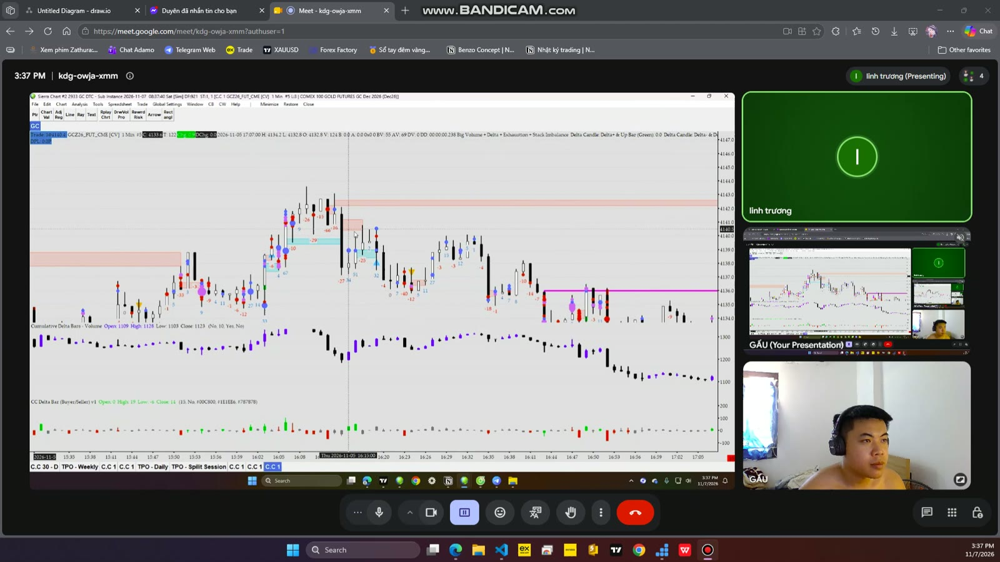 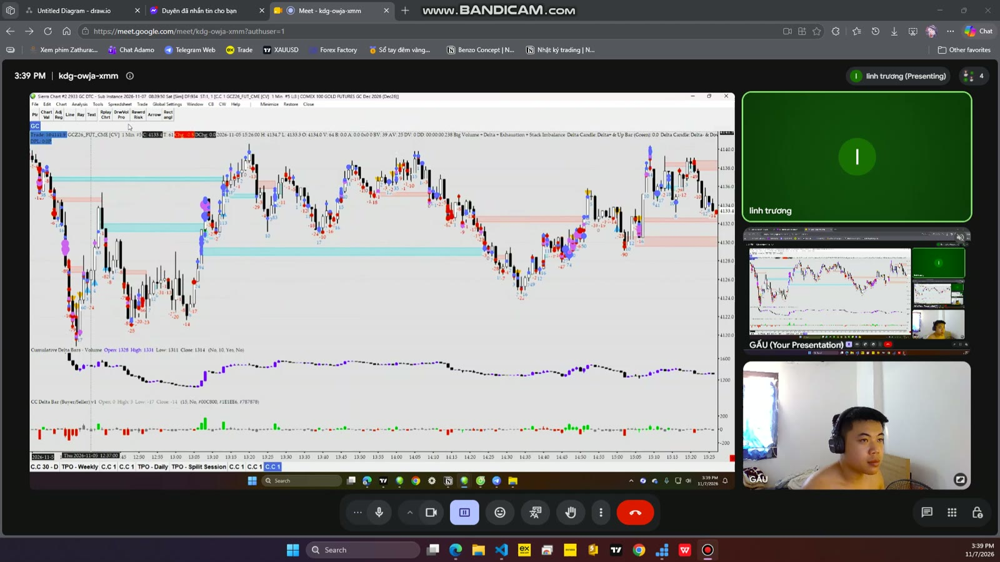

- [1:05:32] [Stacked imbalance] **xa tít thì không dùng**, mấy cái **ở gần thì dùng được**.
- [1:05:40] Trên này tạo stacked imbalance sell, lại phá cái stacked imbalance buy ở đây, **retest lên stacked imbalance sell**, lại giảm xuống. Nhìn bối cảnh rồi biết — quá đẹp.
- [1:05:57] Chơi chỗ này hơi khó. Nếu chơi thì chơi **những đoạn có nhiều tín hiệu cùng lúc** [?] như thế này.
- [1:06:44] **HV:** Cây này vào được không? Cây này cũng phản ứng, nhưng cảm giác SL hơi xa. — Vào được, vì nó phản ứng đẹp rõ như này. Có mỗi cái stacked imbalance buy này nó **không giữ được**, gãy rồi.
- [1:07:44] Đoạn này nhìn hơi khó. Đoạn này chắc phải dùng **range [khung] 15** — range rất to, xuống phản ứng, đi chặn mấy lần.
- [1:08:40] Thường [dùng] range [khung lớn] nhưng trong đó có đấu giá của M1 … vẫn dùng range của M1.
- [1:08:57] Nếu dùng 2 [range lồng nhau] thì [range lớn] chỉ dùng để **đánh dài** thôi.

## 25. HVN / POC trên volume profile nhiều phiên (1:11:00 – 1:19:03)
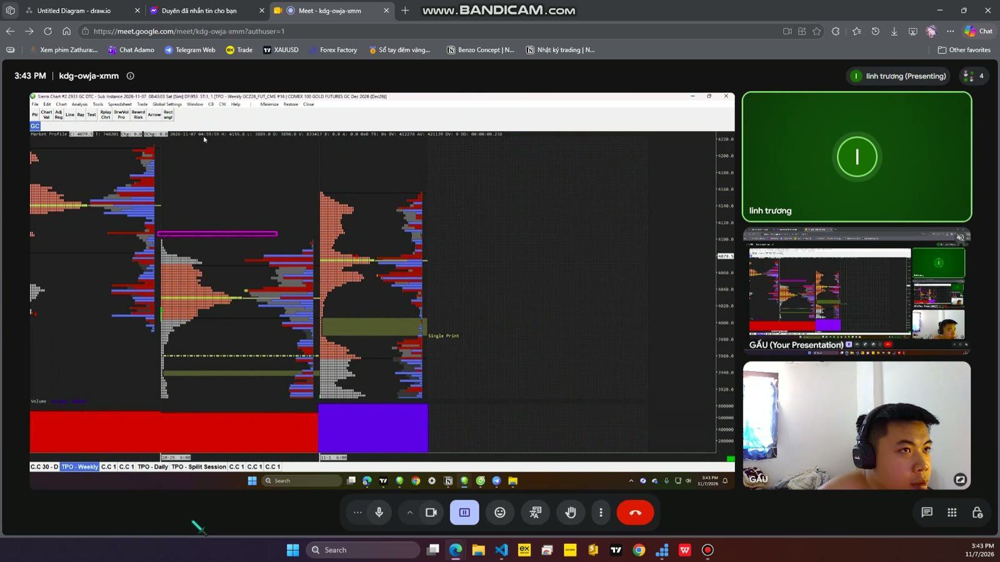 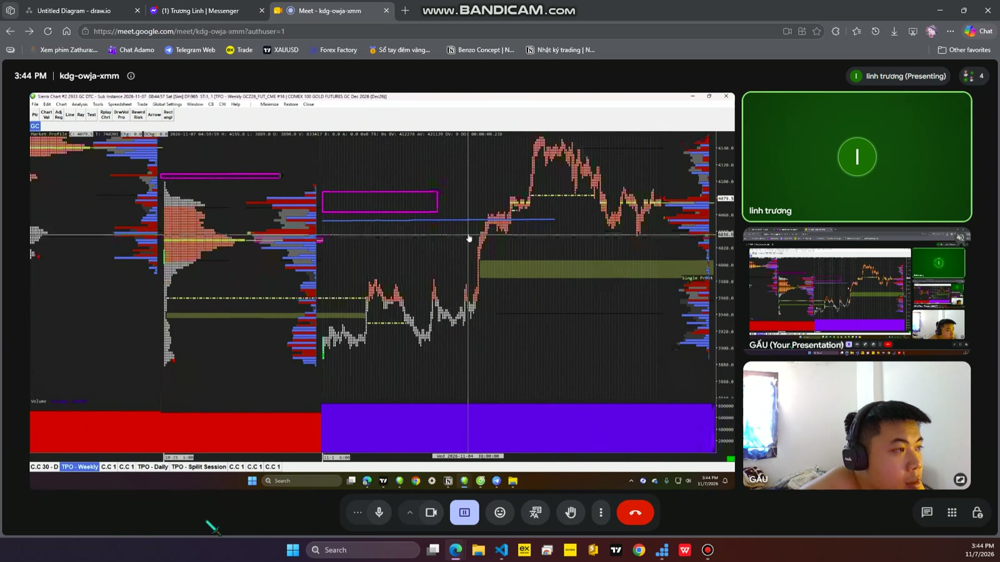 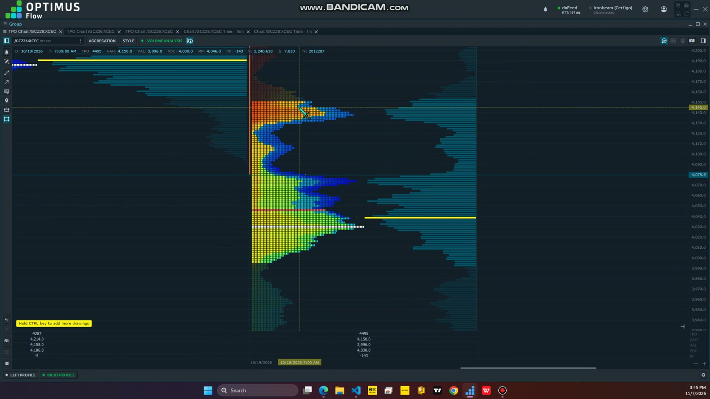

> Người giảng chuyển sang chart **TPO / volume profile tuần** trên Sierra; sau đó người học mở
> **TPO Chart GCZ26 trên Optimus Flow** để hỏi.

- [1:11:00] Nếu giá đang nằm trong 1 vùng này thì **vùng này vẫn chưa có giá trị**.
- [1:11:16] Nếu giá **cắt [ra khỏi] lên** thì vùng này **sẽ có giá trị**.
- [1:11:24] Vì vùng [HVN] này là vùng để [đánh] … [?]. **Khi giá đi ra rồi** thì vùng này mới **bắt đầu có giá trị** → [quay lại test] mới chơi được.
- [1:11:49] Ví dụ tuần này, tuần trước: **chồng nhau thì gộp lại một** [HVN].
- [1:12:04] **Hai HVN chồng nhau thì gộp lại** xem — ở đây chỉ có đúng một HVN này thôi.
- [1:12:47] Nó đi qua, đâm qua luôn — nó không đứng [phản ứng] [?].
- [1:12:59] **Cái HVN kia, đường vàng ấy là POC** — POC cũng là HVN.
- [1:13:41] **Nếu nhiều vùng gần nhau quá thì chọn vùng lớn nhất thôi.**
- [1:14:11] [Nhiều vùng] chồng nhau quá thì chọn **vùng dưới cùng** [?].
- [1:16:56] Nó giống như kiểu bị **break qua, rồi test lại vùng đấy**. Nếu nó [đi] ra rồi thì sẽ dùng **vùng 2 này** [?].
- [1:18:49] **Chồng nhau thì gộp**, không chồng nhau thì [để riêng].

## 26. Ngoài lề (1:19:35 – 1:21:29)
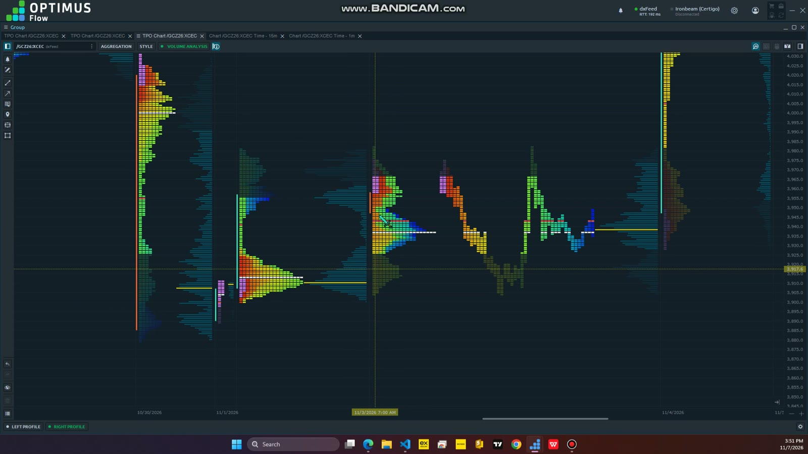

- [1:19:52] **HV:** Data này mua bao nhiêu tiền một tháng? — **19 đô một tháng.** [nguồn dữ liệu người giảng đang dùng; chưa rõ là gói nào]
- [1:21:00] Cái này rẻ nhất, vậy là dùng luôn.

---

## Bảng sửa chữ máy nghe nhầm (dùng cho bản này)
| Máy ghi | Sửa thành |
|---|---|
| Stain Balance / Stacking Balance(d) / stack Invalid / shank imbalances / Stringing Maligno / Stacking Malan / Stake Imbalances / strike imbalance | stacked imbalance |
| Shell / Cell / seo / xeo | sell |
| By / bai / bay | buy |
| kết sức / kế sức / kẻ sức / kẹt sức | kiệt sức (exhaustion) |
| rain / rêng / reng / ring / Ray / RAM / rèn | range |
| công trúc / cơ trúc / cốc trúc / cầu trúc / côn trúc | cấu trúc |
| Chap / Cháp / Trap / tráp / chép | trap (hoặc "test/chạm về" tuỳ câu) |
| Stomp hẳn / Stompean / stoke hắt / stop ăn / stop hang | stop hunt |
| quét L / đặt L / đài L | quét SL / đặt SL |
| bi-stop / By Scope | buy-stop |
| đeo ta / Delta / den lờ (1:06:50) | delta / (den lờ = SL [?]) |
| Bio hay Solaris | buyer hay seller |
| rông nến / rồng nến | râu nến |
| nến ống cửa | nến đóng cửa |
| hai vũ nốt / vùng nốt / mùng | HVN (vùng) |
| sơ tréo A với B | so chéo Ask với Bid |
| FBG | FVG |
| re-tap / tét / rétet | retest / test |
| "2h" ở đoạn 0:58 | 2R |
| BNA (0:25:09) | [sổ lệnh] [?] |

## Đoạn máy bịa đã bỏ (giờ trong buổi)
0:02:18–0:02:28, 0:09:52, 0:10:50–0:10:55, 0:15:42, 0:16:40–0:16:44, 0:25:23–0:25:27 ("666-666"), 0:28:20–0:28:24,
0:34:34, 0:37:14, 0:41:21–0:41:25, 0:47:21, 0:55:24, 1:05:02, 1:06:33–1:06:43 ("Ấm 4" lặp), 1:09:34, 1:10:30–1:10:34,
1:12:17, 1:14:56–1:15:00, 1:16:26–1:16:31, 1:17:51–1:18:18, 1:19:05, 1:21:29.
Các đoạn này là **lúc im lặng** (máy chép lời hay bịa câu "đăng ký kênh" khi không có tiếng) — không mất nội dung.
